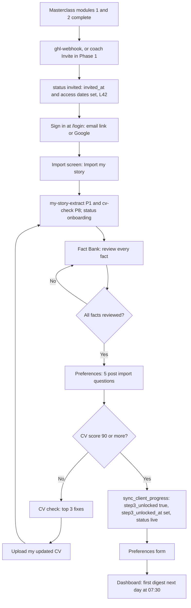
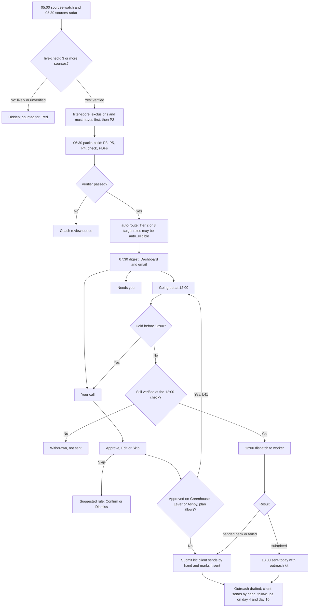
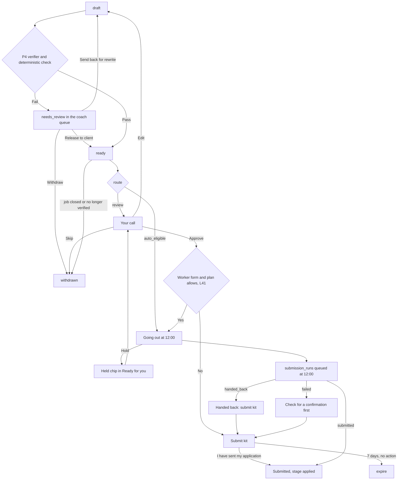
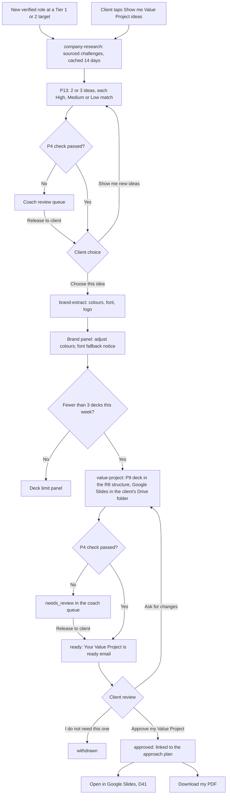
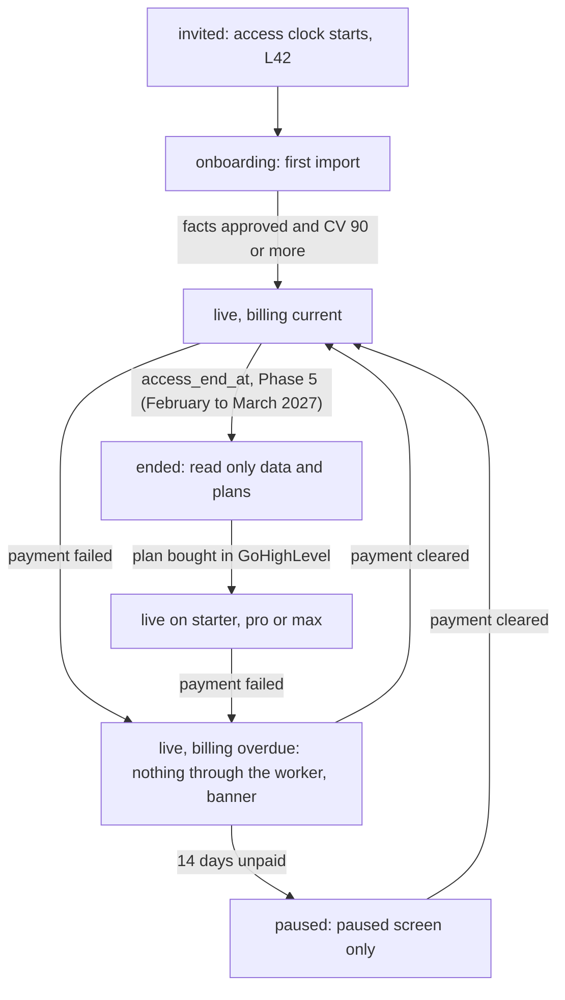

# BOOST App Flow

Answers: where each person goes in BOOST, and what happens after every action.

Last updated: 14 Oct 2026 (canon section 7 of addenda 3 and 4 applied)

Sources: 05 Decision Log (L9, L23, L24, L25, L27, L30, L32, L34 to L50; D6, D20, D34, D40 to D52), CLAUDE.md, addendum 3 (docs/spec/networking-and-gaya.md), addendum 4 (docs/spec/app-shell-and-navigation.md), 06 BOOST Blueprint (screens, daily loop), 04 PRD sections 6 (G1 to G14), 7 (flows) and 8 (F1 to F56), docs/prd.md (6.4 to 6.17), docs/backend-schema.md (function names), docs/spec/worker-interface.md.

How to read this file:

- Times are the client's local time (clients.digest_timezone). Functions are Supabase Edge Functions; tables, columns and enum values follow the canon exactly. "App action" means a Next.js server action writing under RLS.
- Every client and coach action writes an audit_log row; the journeys do not repeat it.
- Text in quotes is client facing and must appear exactly as written.
- [Rec] marks a choice Claude made that Fred has not decided. "Open:" marks a gap: ask Fred before building past it.
- 04 section 7 describes email approval pages. In BOOST every approval happens inside the app; emails only link to it (L25, L27).
- Route names follow addendum 4, section 3. Routes renamed from the first version of this file: /today to /dashboard, /applications to /apply, /pipeline to /tracker, /my-story to /profile, /targets to /profile/targets, /settings/mode to /settings/apply. The old paths redirect (section 2).

## 0. Before you build: decisions, functions, open items

**Locked decisions applied here:**

- L40: only Tier 2 and 3 target company roles can go out without a per pack approval. Wide net roles always need the client's approval; Tier 1 is always Review.
- L41: on the included plans, Pro and Max, an approved Review pack for a Greenhouse, Lever or Ashby form goes out through the worker at the next 12:00 dispatch, authorised by that approval (`authorisation.type: approval`), once worker milestone M4 is met. Other sites get a submit kit; Starter is always by hand (L39). These sends count against the 50 a day ceiling (L23) and the USD 150 budget (L36), not the L30 steps.
- L42: the 3 included months start on `clients.invited_at`; `step3_unlocked_at` is separate; a billing pause does not extend the end date.
- L43: sign in emails go through Supabase custom SMTP on TalentFB's Google Workspace, from boost@talentfb.net. Sign up is disabled.
- L46: every match shows reasons, gaps and the matched words highlighted in the job text. L47: only jobs confirmed live by at least 3 independent sources reach the client. L48: must haves, the 5 post import questions, a rule suggested after each Skip, and the Opportunity brief. L49: BOOST drafts outreach only. L50: Value Projects from sourced research, 2 or 3 rated ideas, the client's choice, a deck in the company's brand.

**Decided by Fred on 14 Oct 2026 (05 D44 to D52):**

- D44: the tab is "Outreach".
- D45: the coach can read clients' Gaya chats, read only, stated in the chat footer and the privacy notice.
- D46: "Your network" stays locked until Phase 5 (L51).
- D47: the LinkedIn people search link is Copy only in v1 (G1).
- D48: phone navigation is a scrollable tab strip under the top bar.
- D49: Research is in scope (Phase 2).
- D50: the Gaya panel is open by default on laptop, then remembered per device.
- D51: before step 3, the client sees Dashboard, Profile and Research; the other four tabs appear together when step 3 unlocks.
- D52: option A. The general shell pattern with BOOST's own tab names, order, design and copy. No copying of Tsenta's interface (06 Risks). Lawyer confirmation still needed before step 1.3.

**Decided by Fred on 14 Oct 2026 (05 D6, D41):**

- D6: the Hold and Back to Review links in emails work without signing in, through single use signed links that expire. Approve always needs a sign in.
- D41: Value Project decks are built as Google Slides in the company's brand, through the Google Slides API on TalentFB's Google Workspace. No PowerPoint. Gamma and pptxgenjs are not used. Decks are stored in one TalentFB Shared Drive, in a folder per client, shared with that client only.

**Recommended and followed until Fred decides:** D40 (live check sources), D42 (company research through the Claude API web search tool).

**Functions.** Canon functions this file uses beyond the first canon: `client-invite` (the Invite button on `/coach`; the app never holds the secret key), `rules-parse`, `job-add`, `live-check`, `company-research`, `brand-extract`, `company-lookup` (addendum 3, "Look up [name]"), `gaya-chat` (addendum 3, Gaya panel).

**Open items** (also marked where they occur):

- Open (D40): whether a role open today on the company's own careers page only counts as verified with fewer than 3 sources [Rec: keep the 3 source minimum; show these to Fred as "Company site only"].
- D41 (PDF): the client also gets a PDF download from the app, decided by Fred on 14 Oct 2026.
- D41 (Drive layout, decided by Fred on 14 Oct 2026): one TalentFB Shared Drive, one folder per client, shared with that client only (restricted sharing). The PDF exported from the approved deck is the approved record. Conditions before the build: a Workspace plan that supports Shared Drives (05 open item 9); clients without a Google account get the PDF only; deletion removes the folder and its trash; access is removed when access ends (L42).
- Open (PRD gap 3): a job the client pastes stays hidden until `live-check` verifies it; may the client still ask for a pack?
- Open (04 F1): consent captured at purchase in GoHighLevel or in BOOST [Rec: first panel of `/profile/my-story/import` when clients.consent_at is empty].
- Open (L30): packs prepared each day before the first 10 clean applications [Rec: up to 5]; whether the 10 must be consecutive.
- Open: whether a CV variation also needs 90 or more; whether a client can add lanes beyond the primary and secondary roles; the maximum number of lanes (addendum 4 section 10 gives no decision ID).
- Open (L35): whether returning to Hybrid or Auto after Back to Review needs a new signature or only Fred's confirmation.
- Open (L36): can Fred raise a client's USD 150 monthly budget (06 Costs suggests it)?
- Open (L38, D34): a notice before access ends; who sees `/plans` before the end date; which GoHighLevel link "Update my payment details" opens.
- Open (addendum 4 vs this file): the addenda ask for the Gaya journey to be "J17", but J17 is the daily limit step here. This file numbers the Gaya journey J24 [Rec].
- Open (addendum 4 section 3): the old paths `/applications/[packId]`, `/jobs/[matchId]` and `/targets/[companyId]` stay as deep links that open the same drawer or company page [Rec].

## 1. Screen inventory

Access states:

| State | Meaning | What the client can open |
| --- | --- | --- |
| Invited | clients.status `invited`, not signed in yet. The invite sets `invited_at` and the access dates (L42) | `/login` |
| Setup | Signed in, `step3_unlocked_at` empty: status `invited` before the first import, `onboarding` after it (trigger `sync_client_progress()`) | `/dashboard` (setup view), `/profile/*`, `/research`, `/settings` (all but export); the other four tabs stay hidden (D51) |
| Unlocked | status `live`. `sync_client_progress()` sets `step3_unlocked_at`, `current_step` 3 and status `live` when `step3_unlocked(client_id)` first returns true: every fact reviewed, at least one approved, latest master CV 90 or more (CLAUDE.md rule 11). Steps 3 to 5 open together; `current_step` stays 3 [Rec]. All seven tabs show at once | Every client screen built so far |
| Overdue | `billing_status` `overdue` | Everything, with a banner; nothing goes through the worker (L37) |
| Paused | `billing_status` `paused` after 14 days unpaid; status `paused` | `/paused` only (L37) |
| Ended | Phase 5 (February to March 2027): status `ended` at `access_end_at`, no monthly plan | Read only data and `/plans` [Rec, D34 item 4] |

Public routes: `/login`, `/auth/callback`, `/paused`. Coach routes: `/coach/*`, coach role only. Every other route is the client's and needs Unlocked unless marked (Setup), which means it opens from the first sign in.

| Route | Screen | Purpose and main actions | Phase |
| --- | --- | --- | --- |
| `/login` | Sign in | "Email me a sign in link", "Continue with Google" | 1 |
| `/auth/callback` | None | Exchanges the code for a session, then redirects (section 2) | 1 |
| `/paused` | Access paused | Paused clients: why, and how access returns; "Update my payment details". Ended clients: "See monthly plans" | 2 |
| `/dashboard` | Dashboard (Setup: setup view) | Date and greeting, mode and daily limit chips, five step progress, the 4 week numbers each with a reason, "Your call" (pack cards: Approve, See my application, Skip), "Needs you" inline, "Going out at 12:00" with Hold, "Follow ups due today", "Top matches today" | 2 (setup view 1) |
| `/profile` | Profile (Setup) | Header card (CV score, facts approved, "Update my story"); sub tabs My Story, CV, Target companies, Preferences, Application answers (sensitive masked) | 1 |
| `/profile/my-story/import` | Import (Setup) | Bring in Masterclass modules 1 and 2 work, later a new CV; "Import my story" | 1 |
| `/profile/my-story/facts` | Fact Bank (Setup) | "This is right", "Correct it", "Remove it", "Add a fact", "I have reviewed all my facts" | 1 |
| `/profile/cv` | CV check (Setup) | Score against 90/100; top 3 fixes below 90; "Upload my updated CV" | 1 |
| `/profile/preferences` | Preferences (Setup) | The 5 post import questions once the facts are approved (L48 b), then titles, levels, compensation floor, location setting, languages, tiers | 1 |
| `/profile/targets` | Target companies | Tiers 1 to 3, watch on or off; "Add a company" | 1 |
| `/profile/targets/[companyId]` | Target company (drawer) | Why it fits; the company block (snapshot, challenges, ideas); open roles; Value Project. Opens the company page in Outreach (`/outreach/company/[companyId]`) from Phase 4 | 1 (company block and decks 4) |
| `/jobs` | Browse jobs | Feed of verified live roles only (L47), scored, with reasons and gaps; "Hide jobs mentioning" field, filter chips, "Tune with Gaya", "Add a job" | 2 |
| `/jobs/saved` | Saved jobs | Saved roles from the feed | 2 |
| `/jobs/[matchId]` | Opportunity brief (drawer) | Score, reasons, gaps and highlighted job text; live sources; company snapshot; 2 or 3 Value Project ideas; people to find; "Next 5 steps" (L46, L48 d). Opens as a drawer over `/jobs` (addendum 4 section 2) | 2 (snapshot and ideas 4) |
| `/apply` | Boost apply | Mode switch (Hybrid and Auto locked with the reason), cards for Mode, Daily limit step, Lanes summary; status tabs Ready for you, Going out today, Submitted, Handed back, Skipped; "Approve all that passed every check" | 2, mode and lanes in 3 |
| `/apply/[packId]` | Application receipt (drawer) | Pack review and edit, submit kit, receipt, proof | 2 (proof 3) |
| `/tracker` | Job tracker | Pipeline: 4 numbers, the 7 stage board (Applied, Approached, Replied, Interviewing, Offer, Not this time, No reply), "Move to", "Export my tracker", "Add an application" | 2 |
| `/tracker/emails` | Employer emails | Forwarding address with Copy, category chips, list and reader, "Move to Interviewing" or "Log a reply", "Draft my reply with Gaya". No Compose: BOOST never sends (G4, G5) | 4 |
| `/outreach` | Outreach | Company search, "Your companies", Follow ups due today, To send, Sent and waiting, Replied; every approach plan and what is due; drafts only (L49) | 4 |
| `/outreach/company/[companyId]` | Company page | Company card, people to find, messages for the open slot, Value Project card, news, "Your network" (locked until Phase 5, D46), applications here | 4 |
| `/outreach/[approachPlanId]` | Approach plan | People to find, messages to copy, "I sent it", "They replied" (unchanged, J13) | 4 |
| `/research` | Research | TalentFB articles with tag filter and read time; the reader ends with "Try it in BOOST" | 2 |
| `/research/[slug]` | Research article | Reader in the 720 px column | 2 |
| `/settings` | Settings | Section index: Apply settings, Lanes, What Gaya knows, Location and exclusions, Notifications, Email forwarding, Plan and access, Data and privacy, Account | 1, grows each phase |
| `/settings/apply` | Apply settings | Mode switch (Review, Hybrid, Auto with lock reasons, Back to Review in one tap), "CV tailoring: Honest", review before submit, daily limit and next step, cover letters. Mode, mandate and limit steps (formerly `/settings/mode`) | 1 (view), 3 (mode) |
| `/settings/lanes` | Lanes | One lane per target role | 1 |
| `/settings/lanes/[laneId]` | Lane | CV variation, must haves and nice to haves (L48 a), filters, keywords, standing instructions, minimum match | 1 (must haves 2, instructions 3) |
| `/settings/gaya` | What Gaya knows | Preferences confirmed in chats, each removable | 2 |
| `/settings/data` | Data and privacy | Export my data, export of the tracker (R7 sheet), "Ask to delete my data" with the DPO line | 1 (export 2) |
| `/plans` | Monthly plans | Ended clients [Rec]: Starter, Pro, Max (L38, L39); "Choose Pro" opens GoHighLevel checkout | 5 (February to March 2027) |
| `/coach` | All clients | Every client's state, counts, alerts and hidden job counts (L47); "Invite a client" | 1 |
| `/coach/clients/[clientId]` | Client view | The client's screens read only, plus coach actions | 1 |
| `/coach/queue` | Review queue | Verifier failures, Needs review packs, ideas and decks, hand backs, failed runs | 2 |
| `/coach/limits` | Limits | Mode unlocks and daily limit steps to confirm | 3 |

Until Phase 4 builds `/outreach`, the outreach kit sits inside `/apply/[packId]` and the Sent today email (06 cut list).

## 2. Navigation

**The shell (addendum 4, section 2).**

- **Laptop (1024 px and up).** A top bar of 64 px: the Gaya toggle, the wordmark, the seven tabs (Dashboard, Browse jobs, Boost apply, Job tracker, Outreach, Profile, Research), then on the right a status pill ("Review · 3 of 5 today"), "Settings", and the account menu. Under it, the search row on every screen (scope select: Everything, Jobs, Companies, Applications; "Search jobs, companies and your applications"). The Gaya panel docks on the left, 380 px, open by default on first visit (D50). Detail views open in a right drawer, 560 px. Max page width 1200 px.
- **Phone (below 1024 px).** A top bar of 56 px: Gaya toggle, mark, settings and account on the right. The status pill moves into Settings and the Dashboard header. The seven tabs are a scrollable pill strip under the top bar (D48), the active tab Midnight with white text. Search row without the scope select. Gaya opens full screen; drawers open full width.
- **Account menu:** name, plan and access end date (a date, never a countdown), My profile, Export or delete my data, Contact your coach, Sign out.
- **Before step 3 unlocks (D51):** Dashboard (setup view), Profile and Research show. The other four tabs stay hidden, not disabled, and appear together when step 3 unlocks.
- **Search results** group as Jobs (opens the job drawer), Companies (opens `/outreach/company/[companyId]`), Your applications (opens the receipt drawer). No result: "Look up [name]", which spends one company lookup (`company-lookup`, addendum 3). Nothing else leaves BOOST from search.
- **Coach.** Sidebar: Clients (`/coach`), Queue and Limits, each with a count. Inside `/coach/clients/[clientId]`, sub tabs mirror the client's navigation, read only.

**Locked screens** never appear in navigation. Opened from a link, they render a locked panel in place with the reason, what unlocks it and one button:

| Locked thing | Panel text | Button |
| --- | --- | --- |
| Step 3 screens in Setup | "Your job search opens once your facts are approved and your CV scores 90 or more." plus the checklist | "Take me to my next task" |
| Hybrid and Auto | "Hybrid and Auto open after 10 approved applications with no factual corrections. You have [6] of 10. Then you sign your Auto mandate and Fred confirms the switch." | "Back to Dashboard" |
| Modes on Starter, Phase 5 (February to March 2027) | "Your Starter plan is manual: you choose each role and send it yourself with your submit kit." | "See monthly plans" |
| Deck at the weekly limit | "You have built 3 Value Projects this week. You can build the next one on Monday." (D20, L32) | None |

**Redirects.** The Next.js middleware refreshes the session, calls the schema's `my_access_state()` (`coach`, `none`, `active`, `automation_paused`, `paused`, `ended`) and applies, in order:

1. `none` on any route except `/login` and `/auth/callback`: redirect to `/login?next=<path>`.
2. `coach` on a client route: redirect to `/coach`. A client on `/coach/*`: the not found page [Rec].
3. `paused`: every route redirects to `/paused`.
4. `ended`, Phase 5 (February to March 2027): `/paused` is the landing page; `/apply`, `/tracker`, `/profile/targets` and `/settings/data` (export only) open read only, with `/plans`; every action and the other routes redirect to `/paused` [Rec, D34 item 4].
5. `active` or `automation_paused` with no my_story_imports row: redirect to `/profile/my-story/import`.
6. Setup on a step 3 route: render the locked panel.
7. Signed in on `/login` or `/`: client to `/dashboard` (Setup: `/profile`), coach to `/coach`.
8. After sign in, return to `next` if it passes rules 2 to 6.
9. Old paths redirect (addendum 4, section 3): `/today` to `/dashboard`, `/applications` to `/apply`, `/pipeline` to `/tracker`, `/my-story` to `/profile`, `/targets` to `/profile/targets`, `/settings/mode` to `/settings/apply`, `/settings/lanes` unchanged. Links in emails already sent keep working.

## 3. Entry points

1. **BOOST invite (from Phase 2, GoHighLevel link).** GoHighLevel sends event `modules_complete` when Masterclass modules 1 and 2 are done. `ghl-webhook` (signed, idempotent) creates the Supabase Auth user without a password and the app_users row (role `client`), sets `invited_at`, `access_start_at` and `access_end_at` (L42); the GoHighLevel workflow sends the invite email linking to `/login`.
2. **Phase 1 pilots.** Until the Google Workspace SMTP (L43) and the GoHighLevel link are live, Fred invites each pilot with "Invite a client" on `/coach` (J23) and sends them the `/login` link himself [Rec].
3. **Sign in.** `/login` by email link (`signInWithOtp` with `shouldCreateUser: false`) or "Continue with Google" with the invited email. Sign up is disabled, so only invited emails can sign in. Sign in emails go through Supabase custom SMTP on TalentFB's Google Workspace, from boost@talentfb.net (L43). Until that is set up, Google sign in works for invited Google accounts. `/auth/callback` exchanges the code for a session; the first sign in lands on `/profile/my-story/import`.
4. **Returning client.** Lands on `/dashboard` (Setup: `/profile`). Sessions persist on the device.
5. **Coach.** Fred's account is created by hand once per environment (schema doc); he signs in the same way and lands on `/coach`.
6. **Payment overdue.** `ghl-webhook` (`payment_failed`) sets `billing_status` `overdue` and `billing_overdue_since`, and alerts Fred. Full access stays, with a banner on every screen: "Your last payment did not go through. Automated sending is paused and your applications wait for you to send them yourself. Update your payment details to resume." Hybrid and Auto behave as Review and approved packs get submit kits; clients.mode is unchanged so it returns when the payment clears.
7. **Paused after 14 days unpaid:** every route shows `/paused` only (J21).
8. **End of access, Phase 5 (February to March 2027):** read only data and `/plans` (J22).
9. **Deep links from emails** open the routes in section 7. Signed out, the client signs in first and returns there. A link to something no longer actionable (already sent or withdrawn) opens its receipt with a note, never an error.

## 4. Journeys

Format: On [screen], user [action] -> [what happens] -> lands on [screen]. Lines starting with a time are scheduled runs.

**J1. First sign in and My Story import**
1. On the invite email, user taps "Open BOOST", then signs in on `/login` (email link or Google) -> `/auth/callback` creates the session -> lands on `/profile/my-story/import`.
2. On `/profile/my-story/import`, if clients.consent_at is empty, user reads the privacy notice and ticks consent -> consent_version and consent_at stored -> stays [Rec].
3. On `/profile/my-story/import`, user uploads the final CV (PDF or Word), pastes positioning, value proposition and LinkedIn text, optionally 2 or 3 writing samples [Rec], and taps "Import my story" -> file to Storage, my_story_imports row (the trigger moves status to `onboarding`); `my-story-extract` (P1) writes unapproved facts, positioning, profile_assets (master CV) and voice_samples; `cv-check` (P8 score only) stores the score and `cv_top_fixes` -> lands on `/profile/my-story/facts`.

**J2. Fact Bank review**
1. On `/profile/my-story/facts`, user taps "This is right" (facts.approved_at set), "Correct it" then "Save my correction" (new approved fact, source `client_edit`; the old one gets superseded_by) or "Remove it" (the unapproved fact is deleted) -> stays. Each write fires `sync_client_progress()`.
2. On a sensitive fact (salary, work_auth, notice, relocation, voluntary self identification stored as `application_default`), user approves one by one, never as a group. Note shown: "Only you and Fred can see this. It is never used to score roles."
3. On `/profile/my-story/facts`, user taps "I have reviewed all my facts" (shown at zero pending) -> lands on `/profile/preferences` for the post import questions (J4), with the CV check next on the checklist if it has not passed.

**J3. CV check**
1. Pass: on `/profile/cv`, user sees "Your CV scores [92]. It meets the TalentFB standard." -> once every fact is reviewed, `step3_unlocked(client_id)` returns true and `sync_client_progress()` sets `step3_unlocked_at`, `current_step` 3 and status `live`; the access dates are not touched (L42) -> lands on `/profile/preferences` with "Your job search is open."
2. Fail: user sees the score and the top 3 fixes; BOOST never rewrites the CV; step 3 stays locked -> stays.
3. On `/profile/cv`, user taps "Upload my updated CV" -> new my_story_imports row; `my-story-extract` proposes only new or changed facts; `cv-check` runs again -> lands on `/profile/my-story/facts` if there are new facts, else stays.
4. After unlock, a new CV under 90 is stored but not used: BOOST keeps the last CV that passed and step 3 stays open [Rec].

**J4. Post import questions and preferences (L48 b, Phase 1)**
1. On `/profile/preferences`, once the facts are approved, user answers 5 short questions, one per card:
   - "Are these still your target roles?" (primary and secondary from the import; confirm or edit);
   - "Which industries are you open to?" (each one "Only this", "Open" or "Not for me");
   - "Which 3 strengths should BOOST put first?" (chosen from approved facts);
   - "What must every role have?" (terms, then "All of them" or "At least one");
   - "What would make you say no straight away?" (deal breakers).
   User taps "Save my answers" -> approved facts of type `preference`; lanes.must_have_terms and must_logic; deal breakers become exclusions or lane rules through `rules-parse`, shown before saving -> stays, with the preferences form below.
2. On `/profile/preferences`, user sets titles, levels (Head of, Director, VP, C level), compensation floor and currency (sensitive: deterministic filter only), workplace, languages, tiers, and the location setting (`local`, `regional` with countries, `global`) with work rights per country, then taps "Save my preferences" -> preferences row, clients.location_scope, work_auth facts -> lands on `/dashboard`. The answers and the location setting are edited later on `/settings/lanes/[laneId]` and `/settings/location`.

**J5. Targets, exclusions and lanes**
1. On `/profile/targets`, user taps "Add a company" with a name or careers page and a tier -> target_companies row; `company-setup` looks for a Greenhouse, Lever or Ashby board -> "Watching their job board" or "No public job board found. BOOST will look for this company in daily searches." (Fred flagged) -> stays.
2. On `/settings/location` (Location and exclusions), user adds an exclusion (current employer, related company, sensitive company, former employer) -> exclusions row; `filter-score` drops matching roles before scoring from the next run (G11) -> stays.
3. On `/settings/lanes/[laneId]`, user picks a CV variation, must haves with "All of them" or "At least one" (with "All", a role missing one is filtered out as "Missing must have: [term]"), nice to haves with a weight, filters, keywords and minimum match (Excellent 90, Strong 80, Good 70; default 80), taps "Save my lane" -> lanes row -> stays (L48 a).
4. On `/settings/lanes/[laneId]`, user writes standing instructions such as "Skip roles below Director" -> `rules-parse` (P10) shows "Here is how BOOST reads this:" with each rule -> user taps "Save these rules" -> standing_instructions and parsed_rules saved -> stays. Rules can only exclude roles.

**J6. The daily loop on Dashboard**
1. 05:00 to 07:00: `sources-watch`, `sources-radar`, then `live-check` (L47): only jobs confirmed live by 3 or more independent sources, one seen in the last 30 days, with no strong ghost signal, become `verified` and go on to `filter-score`, `packs-build` and `auto-route`; `likely` and `unverified` jobs stay hidden and are counted for Fred. Verifier failures go to `/coach/queue`, never to the client. `auto-route` tags a pack `auto_eligible` only in Hybrid or Auto, only when every L35 rule passes, and only for a Tier 2 or 3 target company role: wide net and Tier 1 roles always go to `review` (L40). 07:30: `digest` fills Dashboard and GoHighLevel sends the email (none if nothing is new).
2. On `/dashboard` "Going out at 12:00", user taps "Hold my application" and picks a reason -> `pack-action` hold: packs.held_at and hold_reason, approvals `hold`; the pack will not go at 12:00 -> it moves to "Your call" with a Held chip; after 12:00 it stays in Ready for you with the chip. Approving it later sends it by hand, or at the next 12:00 dispatch where L41 allows [Rec].
3. On `/dashboard` "Your call" (target company hits first), user taps "Approve my application" -> `pack-action` approve: approvals row, applications row (not yet sent). Then (L41): a Greenhouse, Lever or Ashby form on the included plan, Pro or Max gets packs.dispatch_date set to the next 12:00 and moves to "Going out at 12:00" with Hold -> stays on `/dashboard`. Any other site, or Starter, gets a submit kit -> lands on `/apply/[packId]`. In Auto mode, packs that fail an auto rule sit under "Optional" with Approve and Skip (04 7.2).
4. On `/dashboard`, user taps "Edit my application", writes the change, picks its kind ("A fact is wrong", "Wording or emphasis", "Something is missing") and taps "Send my changes" -> `pack-action` edit: approvals `edit`, with `factual_correction` true for "A fact is wrong" (that pack no longer counts among the 10 clean applications, L30); `packs-build` writes and verifies a new version -> stays.
5. On `/dashboard`, user taps "Skip this role" and picks a reason -> `pack-action` skip: approvals `skip`, packs.status `withdrawn`; the reason feeds the rubric -> the card moves to Skipped and a suggested rule card appears (step 6).
6. On the suggested rule card, for example "Hide roles that require Mandarin?", user taps "Confirm" -> `rules-parse` saves the rule to lanes.parsed_rules or exclusions, from the next run; or taps "Dismiss" -> nothing changes (L48 c). One card per Skip at most; none when the reason gives nothing to learn from ("Other" with no text) [Rec].
7. Hold and Skip reasons [Rec]: "Not the right level", "Wrong location", "Not a company for me", "The role is not a fit", "I want to apply myself", "Something in it is wrong", "Other" (with text).
8. On `/dashboard` "Needs you", user answers, optionally ticks "Save this answer to my Fact Bank for next time", taps "Save my answer" -> client_questions answered; if ticked, a new approved fact (`application_default` or its sensitive type); the pack is checked again -> the card leaves Needs you.
9. 11:45 to 12:00: `live-check` and `freshness` run again; a pack whose job is no longer verified is withdrawn and not sent [Rec]. 12:00: `dispatch` (J12). 13:00: `sent-today` emails the receipts; its "See today's applications" link lands on `/apply?tab=submitted`, each receipt with its outreach kit. Three Holds in a week flag the client on `/coach`.

**J7. Browse jobs**
1. On `/jobs`, user sees verified live roles only (L47), each with its score, at least 2 reasons, the gaps and a "Verified live" chip; user sets filters (date, location, workplace, level, compensation, tier, lane, Target company or Wide net) -> list updates; filters remembered on the device [Rec].
2. On `/jobs`, user taps "Tune with Gaya" and types "Only fintech and payments, nothing below VP" -> `rules-parse` shows the filters it read -> user taps "Save these filters" -> preferences updated from the next run -> stays.
3. On `/jobs`, user taps "Add a job" and pastes a link -> `job-add` stores the job, then `live-check`: verified, it is scored and, if it passes the filters, gets a pack and approach plan -> opens `/jobs/[matchId]` as a drawer; not yet verified -> stays, with "BOOST could not confirm this role is live yet." (section 5). Open (PRD gap 3): whether the client may ask for a pack anyway.
4. On `/jobs/[matchId]`, user taps "Not for me" with a reason -> as J6 steps 5 and 6 -> closes the drawer on `/jobs`.

**J8. Opportunity brief (`/jobs/[matchId]`, L48 d; basic in Phase 2, snapshot and ideas in Phase 4)**
1. On `/jobs` or a Dashboard card, user opens a role -> the drawer opens with, top to bottom: the score with "Why it fits" and "Gaps" (a missing must have reads "Missing must have: [term]"); the job text with the matched terms from matches.matched_terms_json highlighted, must haves in one style and other matches in another, with a legend (L46); the live block "Verified live: [3] sources"; the company snapshot; the Value Project ideas; the people to find; "Next 5 steps".
2. On the live block, user taps "See the sources" -> each source from jobs.live_sources_json with its link and the date it was seen -> stays.
3. Company snapshot (Phase 4): a short summary and the current challenges from company_research, each with a source link and date, worded as a hypothesis ("From what is public, it looks like ...", G14). With no research yet, user taps "Show me Value Project ideas" -> J19 step 1 -> stays.
4. Ideas: 2 or 3 cards, each with a title, the company problem with its sources, "My angle" (the facts it rests on), "Why now" and a "High match", "Medium match" or "Low match" chip with the reasons. User taps "Choose this idea" (J19 step 3) or "Show me new ideas" (J19 step 2).
5. People to find: 2 hiring managers, 1 recruiter and 1 referrer as titles and teams, never names in v1 (L32, G13). User taps "Open my approach plan" -> lands on `/outreach/[approachPlanId]`. A wide net role shows "Plan an approach for this role" instead [Rec].
6. "Next 5 steps": "Tailor my CV and letter", "Approve or apply", "Choose a Value Project", "Approach the hiring manager", "Ask for a referral". Each links to where it is done and ticks itself from the pack, the approval or "I have sent my application", the chosen idea and the Sent marks [Rec].
7. User taps "See my application" -> opens `/apply/[packId]` as a drawer.
8. The same company block (snapshot, challenges, ideas) appears on `/outreach/company/[companyId]` (Phase 4) and `/profile/targets/[companyId]`.

**J9. Boost apply and the receipt**
1. On `/apply`, user switches tabs -> `?tab=` changes:
   - Ready for you (`ready`): "Waiting for your approval", "Approved: send it yourself" (other sites, Starter, payment overdue, budget used) and held packs with a Held chip.
   - Going out today (`going-out`): `auto_eligible` packs and approved packs booked for the worker (L41), each with Hold and a "Today at 12:00" or "Tomorrow at 12:00" chip.
   - Submitted, Handed back, Skipped.
2. On `/apply?tab=ready`, user taps "Approve all that passed every check" (shown only after 10 clean applications; never Tier 1 or packs with a Needs you question) -> one `pack-action` approve per pack, each routed as J6 step 3 -> stays (06).
3. On `/apply/[packId]`, user taps a sentence in the CV or letter -> the Fact Bank entry behind it shows. The receipt also shows each form answer and its source, the verifier result, the auto rules that passed, how it was authorised (approval or mandate), the proof, the job post and forwarded employer emails.

**J10. Submitting by hand** (other sites, Starter, payment overdue, budget used, and every hand back)
1. On `/apply/[packId]`, user uses the submit kit: "Open the job page", "Download my CV", "Download my cover letter", "Copy" on each answer, then applies on the employer's site.
2. User taps "I have sent my application" -> applications.submitted_at, route `client_self`, stage `applied`, approach plan active -> lands on `/outreach/[approachPlanId]` with "Next: approach the hiring manager" (before Phase 4: the kit on the same page).
3. User forwards the employer's confirmation to their forwarding address -> `inbox-parse` attaches it as proof.
4. 72 hours after approval without "I have sent my application": `reminders` sends one reminder. After 7 days: approvals `expire`; the card moves to Skipped, where "I sent it after all" stays available [Rec].

**J11. Hand back from the worker** (runs authorised by an approval under L41, or by the mandate)
1. `submission-callback` receives `handed_back` -> submission_runs updated, client notified and emailed, a row on `/coach/queue`; the pack shows in Handed back with its submit kit and this text:

| Reason | What the client sees |
| --- | --- |
| `captcha` | "This form asks for a security check that BOOST never completes for you. Your submit kit is ready." |
| `login` | "This employer asks you to sign in before applying. BOOST never signs in for you. Your submit kit is ready." |
| `account` | "This employer asks you to create an account. BOOST never creates accounts for you. Your submit kit is ready." |
| `email_code` | "This employer sent a code to your email. BOOST never reads your email, so please apply yourself. Your submit kit is ready." |
| `unknown_field` | "The form asked something you have not answered yet: [question]. Answer it below, then apply with your submit kit." A client_questions row with the options is created. |
| `closed` | "This role closed before it went out. Nothing was sent." Pack withdrawn; no submit kit. |
| `unsupported` | "This employer uses a form BOOST does not fill in. Your submit kit is ready." |
| `page_error` | "The employer's page did not load properly. Nothing was sent. Your submit kit is ready." |
| `other` | "Something on the form stopped BOOST before sending. Nothing was sent. Your submit kit is ready." |

2. Status `failed` (clicked, no confirmation): "BOOST clicked send but the employer showed no confirmation. Check your email for a confirmation before you apply again, so you do not apply twice." Buttons "I found a confirmation" (marks it sent) and "No confirmation, I applied myself". Fred alerted. Never a second automated attempt.
3. On `/apply/[packId]`, user answers and sends by hand -> J10 step 2. No automatic retry [Rec]; the saved answer serves the next forms.

**J12. Sending through the worker**
1. 12:00: `dispatch` takes two kinds of pack: `auto_eligible` packs under the signed mandate (L35), and approved packs booked under their approval (L41). For each: still verified live, not held, job open, employer cap, `billing_status` `current`, budget left and room under the 50 a day ceiling; mandate packs also need the mandate active and room under the daily limit step. Then submission_runs `queued`, mode `live`, a signed `proof_upload_url`, the worker call -> `submission-callback` `submitted` with proof -> applications.submitted_at, route `auto_agent`, authorisation the approval or the mandate, proof_path, stage `applied`. A Hold after `dispatch` claimed the pack gets the "Too late" error (section 5).
2. Until the worker's live mode is accepted (M4, 4 Jan 2027) and live runs widen in Phase 4, every approved pack gets a submit kit instead.

**J13. Outreach (BOOST drafts only, L49)**
1. On `/outreach`, user opens a company (`/outreach/company/[companyId]`) or a plan (`/outreach/[approachPlanId]`): 2 hiring managers, 1 recruiter, 1 referrer to find, with likely titles, search words to copy, warm up steps the client does by hand, and drafted messages.
2. User taps "I found this person" and pastes a name, title and LinkedIn link -> contacts row (G13 fields only; no email or phone field exists); `outreach-personalise` (P5) rewrites the draft within 2 minutes -> stays.
3. User taps "Copy message", sends it by hand from their own LinkedIn or email, taps "I sent it" -> outreach.sent_at, next_reminder_at day 4, stage `approached` -> stays. BOOST never sends, connects, likes, comments or messages on LinkedIn or any other platform for the client (L49, G1).
4. Day 4 and day 10: `reminders` adds "Follow up due" to Dashboard and emails the drafted text -> user taps it -> lands on `/outreach/[approachPlanId]` with the follow up ready to copy.
5. User taps "They replied" -> outreach.reply_at and reply_type, outcomes row, stage `replied`, follow ups stop -> stays.
6. Wide net roles carry no kit by default; the receipt says "Wide net role: no approach planned." with "Plan an approach for this role" [Rec] (L36).

**J13a. Find a company and plan the approach (addendum 3, Phase 4)**
1. On `/outreach`, user types a company in "Find any company". A company already in BOOST appears from the shared table; a new one shows "Look up [name]" -> `company-lookup` (cap 10 a day, counter in the header "7 of 10 company lookups left today") -> lands on `/outreach/company/[companyId]`. At 0 lookups: "That is today's 10 lookups. Your saved companies stay open."
2. On the company page, user taps "Build my approach plan" -> approach_plans row (pack_id null) -> stays, with the four people to find.
3. User taps "I found this person" and pastes a name, title and profile link -> `outreach-personalise` (P5) -> the slot shows "Found" -> stays.
4. User taps "Copy message", sends it by hand, taps "I sent it" -> outreach.sent_at, stage `approached`, day 4 follow up set -> stays.
5. User taps "Rewrite with Gaya" -> opens the Gaya panel with the draft attached (J24).

**J14. Job tracker and forwarded email**
1. On `/tracker`, user moves a card ("Move to" on phone and desktop, never dragging) -> applications.stage; outcomes row for `replied`, `interviewing`, `offer`, `rejected` -> stays.
2. User forwards an employer email to clients.forwarding_address -> `inbox-parse` (P11) stores inbox_messages with a category and the matching application -> the card shows "New email: interview" with "Move to Interviewing"; BOOST never moves a stage on its own [Rec]. No match: listed under "Unmatched emails" for the user to attach. The list and reader sit on `/tracker/emails` (Phase 4).
3. On `/tracker`, user taps "Log a reply" -> as J13 step 5.

**J15. Weekly report**
1. Sunday 22:00: `weekly-report` (P6) writes weekly_reports; Monday 08:00 GoHighLevel emails it, Fred copied -> user taps "Read my weekly report" -> lands on `/tracker?view=report`.

**J16. Mode, mandate and Back to Review**
1. On `/settings/apply`, user (past the L35 conditions, on the included plan, Pro or Max) picks Hybrid or Auto and reads the mandate: lanes and levels, locations, threshold 80, daily limit, supported forms only, listed at 07:30 and sent at 12:00 unless held, only Tier 2 and 3 target company roles go out without your approval (wide net and Tier 1 roles always wait for you, L40), the employer sees you as the applicant with your own email and phone, consent to the employer's privacy notice on your behalf, Back to Review at any time.
2. User types their full name and taps "Sign my Auto mandate" -> auto_mandates row (version, rules_json, signed_at); Fred alerted -> stays, showing "Waiting for Fred".
3. On `/coach/limits`, Fred taps "Confirm Hybrid" -> confirmed_by_fred_at, clients.mode, client emailed -> applies from the next `auto-route` run.
4. On `/dashboard`, `/settings/apply` or a digest email, user taps "Switch me back to Review" -> `pack-action` Back to Review: clients.mode `review`; every unsent `auto_eligible` pack gets route `review` -> lands on `/dashboard`. Approved packs booked under L41 keep their booking.

**J17. Daily limit step**
1. On `/coach/limits`, Fred sees a client eligible to step up, with approvals, corrections, hand backs and replies, and taps "Raise to 10 a day" in the weekly call -> clients.daily_limit, limit_approved_at; client notified -> `/settings/apply` shows the new limit. Steps: 5, 10, 25, 50 (L30). They govern Hybrid and Auto only.

**J18. Budget reached**
1. automation_spend reaches USD 150 for the month -> Fred alerted; `auto-route` tags further packs `review` and approved packs get submit kits -> Dashboard banner: "This month's automated sending budget is used. New applications come to you to approve and send yourself until [1 Nov]." (L36).

**J19. Value Project: research, ideas, deck (L50, Phase 4; the same flow on the Opportunity brief, `/outreach/company/[companyId]` and a pack)**
1. A new verified role at a Tier 1 or 2 target starts it automatically; for any other role, or a target with no open role, user taps "Show me Value Project ideas" -> `company-research` gathers sourced challenges into company_research (cached 14 days; only company names and queries leave BOOST, D42 [Rec]); P13 writes 2 or 3 value_project_ideas (`suggested`), each with a match level and reasons; P4 checks them -> stays, with the idea cards.
2. User taps "Show me new ideas" -> the current ideas become `dismissed`; P13 proposes new ones from the same research -> stays.
3. User taps "Choose this idea" -> the idea becomes `chosen`; `brand-extract` (if not done) stores companies.brand_json and logo_path -> the brand panel opens: colour swatches, the font, the logo and "The logo is used only in this deck, addressed to [company]."
4. In the brand panel, user taps "Adjust colours" and changes a swatch -> kept for this deck only -> stays. If the company font is not available: "[Font] is not available, so your deck uses [closest font], the closest match."
5. User taps "Build my deck" (3 a week, L32) -> `value-project`: P9 writes the deck from the chosen idea in the R8 structure; P4 checks every client claim against facts and every company statement against a source; BOOST builds the deck as a Google Slides presentation in the company's brand, through the Google Slides API, in the client's folder in TalentFB's Drive, shared with the client (D41); value_projects row with idea_id, brand_snapshot_json, renderer `google_slides`, slides_file_id, drive_folder_id -> stays, with "BOOST is building your deck. This takes a few minutes."
6. P4 fails -> `needs_review` on `/coach/queue`; the client sees "Being checked".
7. Ready -> "Your Value Project is ready" email -> user opens the deck -> slide preview, each company statement with its source and date (G14), each claim about the client linked to its fact.
8. User taps "Approve my Value Project" -> `approved`, linked into that company's approach plan -> stays. "Ask for changes" with a note -> a new version. "I do not need this one" -> `withdrawn`.
9. After approval, user taps "Open in Google Slides" -> the deck opens in a new tab from the client's folder, shared with them (D41). Edits made there stay in Google Slides and are not sent back to BOOST [Rec].
10. After approval, user taps "Download my PDF" -> a signed link to the PDF exported from the deck -> the file downloads (D41).

**J20. Export and deletion**
1. On `/settings/data`, user taps "Export my tracker" -> `tracker-export` writes the R7 Google Sheet and shares it with the client -> stays, with "Open my tracker".
2. On `/settings/data`, user taps "Ask to delete my data" and types DELETE -> clients.deletion_requested_at set, Fred alerted, confirmation email -> stays.
3. On `/coach/clients/[clientId]`, Fred taps "Run deletion" -> `client-deletion` removes every row and file (decks, value_project_ideas, gaya_threads, gaya_messages, company_lookups and network_connections included) and writes an audit stub without personal data; GoHighLevel sends the final email -> lands on `/coach`.

**J21. Billing overdue and paused (L37)**
1. GoHighLevel reports a failed payment -> `ghl-webhook` sets `overdue` and `billing_overdue_since`, Fred alerted, the banner shows (section 3, item 6); nothing goes through the worker -> the client stays where they are.
2. Payment clears -> `ghl-webhook` sets `current`; the banner goes; the mode applies again from the next run.
3. Day 14 unpaid -> `access-lifecycle` pauses -> user opens any link -> lands on `/paused`, the only screen open: "Your BOOST access is paused because a payment is overdue. Your data is kept. Access returns as soon as the payment clears." with "Update my payment details". The pause does not extend `access_end_at` (L42).

**J22. End of access and plans, Phase 5 (February to March 2027), L38, L39**
1. At `access_end_at` (3 months after `invited_at`, L42) -> `access-lifecycle` sets `ended` unless a plan is active; pending packs withdrawn; no further runs; GoHighLevel sends the offer -> user taps "See monthly plans" -> lands on `/plans`. Read only data stays open [Rec, D34 item 4].
2. On `/plans`, user taps "Choose Pro" -> GoHighLevel checkout -> `ghl-webhook` (`plan_started`) sets clients.plan, the access dates, status `live`, `billing_status` `current` -> lands on `/dashboard`.
3. Starter: mode fixed at `review`; nothing goes through the worker; the client applies or rejects each suggested role and sends it with the submit kit (L39). `monthly_application_cap` stays null until the limits are fixed in March 2027.

**J23. Coach journeys**
1. On `/coach`, Fred taps "Invite a client" (Phase 1 pilots, until the Google Workspace SMTP (L43) and the GoHighLevel link are live), enters a name and email -> `client-invite` creates the clients row (status `invited`, `invited_at`, access dates), the Auth user without a password and the app_users row -> stays, with the client listed as Invited; Fred sends the `/login` link himself [Rec].
2. On `/coach`, Fred sees per client: step, mode, billing status, packs waiting, stalled approvals, verifier failures, Holds this week, hand backs, budget used, access end date, and hidden job counts (`likely`, `unverified`, and "Company site only" [Rec, D40]); opens one -> lands on `/coach/clients/[clientId]`.
3. On `/coach/queue`, Fred reads P4's output on a verifier failure (pack, idea or deck) and taps "Send back for rewrite", "Release to client" (status `ready`, logged as Fred's override) or "Withdraw" -> stays.
4. On `/coach/queue`, Fred reads a hand back or failed run (steps, screenshot) and taps "Mark checked" -> stays.
5. On `/coach/limits`, Fred confirms or declines a mode unlock (J16) or a limit step (J17). "Decline" needs a note, shown to the client.
6. On `/coach/clients/[clientId]`, Fred can Hold a pack going out at 12:00 or tap "Stop automated sending" (same as Back to Review), but never approves, edits or skips for the client (G2).
7. Phases 2 to 4 [Rec]: on a pilot pack the client approved, Fred taps "Start a dry run" (worker mode `dry_run`, authorisation the approval) and checks the screenshot; first live runs follow one at a time (worker spec M4).

**J24. Ask Gaya (addendum 3, section 5, Phase 2)**
1. On any client screen after step 3 unlocks (or on Profile before it, for the import and CV fixes only), user opens the Gaya panel from the top bar or with the page's starter chip -> the context chip shows the current screen, for example "Looking at: Browse jobs" or "Looking at: Northwind Payments" -> stays.
2. User types a question or taps a starter chip, for example "Draft my note to the recruiter" -> `gaya-chat` (P14) streams the reply; drafts come back as draft cards with "Use this note" and "Copy" -> stays. Drafts are never sent (L49).
3. User taps "Use this note" -> the text fills the open slot's textarea, unsaved until edited or copied -> stays.
4. User taps "Switch chat" or "New chat" -> gaya_threads row; the thread title updates from the first message -> stays.
5. Limits: 40 client messages a day, reset at local midnight; at the cap: "That is today's limit for Gaya. Your drafts and plans are all saved." (addendum 3, section 5.7). Gaya never names a person it was not given, never sends, applies or approves, and uses only approved facts (addendum 3, section 5.3).

## 5. Action to result table

Every action's error message says whether anything was sent. Default error: "Something went wrong on our side. Nothing was sent. Please try again in a minute." While an action runs, its button shows a spinner and the rest of the screen stays usable; any working text is given below. Copy buttons answer "Copied" and are not listed; CV and letter downloads start the file and are not listed.

**`/login`**. Empty state: none.

| Action | On success | Error message |
| --- | --- | --- |
| "Email me a sign in link" | "Check your email. The link works for one hour." While working: "Sending your link" | "This email has no BOOST invite. Use the email you use for the Masterclass, or reply to your invite email." |
| "Continue with Google" | Signed in, redirect | "Your Google email does not match your BOOST invite. Use the invited email instead." |
| Expired link | None | "This sign in link has expired. Ask for a new one below." |

**Profile (My Story).** Empty states: import "Bring in your work from Masterclass modules 1 and 2."; facts "No facts were found. Check your CV upload, or add your facts below."; CV check "Import your CV first."

| Action | On success | Error message |
| --- | --- | --- |
| Upload CV | File name shown | "This file is not a PDF or Word file." / "This file is over 10 MB." [Rec] |
| "Import my story" | Lands on `/profile/my-story/facts`. While working: "Reading your CV and your Masterclass work. This takes about a minute." | "BOOST could not read text in this file. Upload a PDF exported from Word or Google Docs, not a scan." |
| "This is right" / "Remove it" | Fact moves | "This fact could not be saved. Please try again." |
| "Save my correction" | Corrected fact approved | "Add the corrected text first." |
| "Add a fact" | New approved fact | "Choose what kind of fact this is." |
| "I have reviewed all my facts" | Next step. While working: "Checking your setup" | "You still have [3] facts to review." |
| "Upload my updated CV" | New score; pass message or 3 fixes. While working: "Checking your CV against the TalentFB standard" | As "Import my story" |
| "Save my answers" (5 questions) | "Saved. Your must haves and deal breakers apply from tomorrow's 05:00 run." | "Choose 3 strengths." / "Add at least one must have, or tick I have no must haves." |
| "Save my preferences" | "Saved. Changes apply from tomorrow's 05:00 run." | "Choose at least one country." (regional with none) |

**Settings.** Empty state: exclusions "No companies excluded yet. Add your current employer first."

| Action | On success | Error message |
| --- | --- | --- |
| "Save my changes" | "Saved." | Default |
| Add an exclusion | Listed | "This company is already on your list." |
| "Export my tracker" | "Your tracker is ready." While working: "Building your tracker" | "Your tracker could not be created. Nothing changed. Please try again." |
| "Ask to delete my data" | "Your request is received. Your data is deleted within 30 days and you will get a final email." | "Type DELETE to confirm." |

**Dashboard.** Empty state: "Nothing needs you today. BOOST looks for new roles every morning and your next digest arrives at 07:30." Before the first run: "Your first roles arrive tomorrow at 07:30."

| Action | On success | Error message |
| --- | --- | --- |
| "Hold my application" | "Held. This one will not go out at 12:00. You can approve it later." | "Too late to hold this one: it is already going out. You will see it in Sent today." |
| "Approve my application" | Worker form (L41): "Approved. It goes out at 12:00 today." or "Approved. It goes out tomorrow at 12:00." Other sites and Starter: "Approved. Your submit kit is ready: this employer's site needs you to apply yourself." | "This role has closed. Nothing was sent." / "You already have 2 applications at this company group in the last 90 days, so this one cannot go out." |
| "Send my changes" (Edit) | "Your updated application will be ready in a few minutes." While working: the card shows "Rewriting" | "Tell BOOST what to change." |
| "Skip this role" | Card leaves with "Skipped"; the suggested rule card may follow | Default |
| "Confirm" (suggested rule) | "Done. [Hide roles that require Mandarin] from tomorrow's run." | Default |
| "Dismiss" (suggested rule) | Card closes; nothing changes | None |
| "Save my answer" | Card leaves Needs you | "Add your answer first." |
| "Switch me back to Review" | "You are in Review. Nothing goes out without your approval." | Default |

**Browse jobs.** Empty states: nothing verified yet: "No roles are confirmed live yet. BOOST shows a role only once at least 3 independent sources show it is open, so you never spend time on a closed or inactive job. New roles are checked every morning." Filters too narrow: "No live roles match your filters. Try fewer filters, or tune your feed."

| Action | On success | Error message |
| --- | --- | --- |
| "Save these filters" | "Saved. Your feed changes from tomorrow's run." While working: "Reading your request" | "BOOST could not turn this into filters. Try naming a sector, level or place." |
| "Add a job" | Verified: opens `/jobs/[matchId]`. While working: "Reading the job page and checking it is live" | Not yet verified: "BOOST could not confirm this role is live yet. It checks again tomorrow and adds the role once 3 sources show it is open." / "This link does not open a job page." / "This company is on your confidentiality list." / "You already have this role." |
| "Not for me" | Back to the feed; the suggested rule card may follow | Default |

**Opportunity brief (`/jobs/[matchId]`).** Empty states: snapshot before Phase 4 or before research: "No company research yet."; ideas: "BOOST is researching this company. Your ideas appear here in a few minutes."; people to find on a wide net role: "No approach planned for this role."

| Action | On success | Error message |
| --- | --- | --- |
| "See the sources" | Source list opens | None |
| "Show me Value Project ideas" | Idea cards appear. While working: "BOOST is researching this company. Your ideas appear here in a few minutes." | "BOOST could not find enough public sources on this company yet. Nothing was created." |
| "Choose this idea" | Brand panel opens | "This idea is no longer available. Ask for new ideas." |
| "Show me new ideas" | New idea cards | "BOOST could not find a new angle yet. Your current ideas are kept." |
| "Open my approach plan" / "Plan an approach for this role" | Opens `/outreach/[approachPlanId]` | "Your approach plan is being written." |
| "See my application" | Opens the pack | "Your application is being written." |

**Boost apply.** Empty states: "Nothing waiting for you.", "Nothing is going out at 12:00.", "No applications sent yet.", "Nothing handed back.", "Nothing skipped."

| Action | On success | Error message |
| --- | --- | --- |
| "Approve all that passed every check" | "Approved [4] applications. [3] go out at 12:00 and [1] needs you to send it yourself." | "[3] approved. [1] needs you: open it to see why." |
| "Hold my application" (Going out tab) | As on Dashboard | As on Dashboard |
| "I have sent my application", "I found a confirmation", "No confirmation, I applied myself", "I sent it after all" | "Marked as sent." | Default |
| "Show me Value Project ideas" (from a pack) | As on the Opportunity brief | As on the Opportunity brief |

**Outreach.** Empty state: "Your approach plans appear here once your first application is ready."

| Action | On success | Error message |
| --- | --- | --- |
| "Personalise for this person" | Draft rewritten. While working: "Rewriting your message" | "Paste the link to their LinkedIn profile." |
| "I sent it" | "Marked as sent. BOOST reminds you to follow up on day 4." | Default |
| "They replied" (also "Log a reply" on Job tracker) | "Logged. Follow ups stopped." | Default |
| "Look up [name]" | Company page opens. The counter drops by one | "That lookup did not work. It was not counted." At 0: "That is today's 10 lookups. Your saved companies stay open." |

**Job tracker.** Empty state: "Your applications appear here once you send the first one."

| Action | On success | Error message |
| --- | --- | --- |
| Move a card, "Move to Interviewing" | Card in the new column | "This change was not saved. Please try again." (card returns) |
| Attach an unmatched email | Shows on the card | Default |
| "Read my weekly report" | Report panel | "Your first weekly report arrives on Monday." |

**Targets and Value Projects** (`/profile/targets`, `/outreach/company/[companyId]`, and the brief). Empty state: "Add the companies you most want to work for. Tier 1 is your top choice."

| Action | On success | Error message |
| --- | --- | --- |
| "Add a company" | Listed with its board status. While working: "Looking for their job board" | "This company is on your confidentiality list." |
| Change tier, watch on or off | Saved | Default |
| "Show me Value Project ideas", "Choose this idea", "Show me new ideas" | As on the Opportunity brief | As on the Opportunity brief |
| "Adjust colours" | "Colours updated for this deck." | "Choose a colour from the picker." |
| "Build my deck" | "BOOST is building your deck. This takes a few minutes." | Deck limit panel (section 2) / "Your deck could not be built. Nothing was created. Please try again." |
| "Approve my Value Project" | "Approved. It is linked to your approach plan." | Default |
| "Ask for changes" | "A new version is being built." | "Tell BOOST what to change." |
| "I do not need this one" | "Removed." | Default |
| "Open in Google Slides" (D41) | Deck opens in a new tab | "This deck is not shared with your Google account yet. Ask BOOST to share it again." |
| "Download my PDF" | File downloads | "This file could not be downloaded. Please try again." |

**Mode and lanes.** Empty state: "Your lanes are created from your primary and secondary roles."

| Action | On success | Error message |
| --- | --- | --- |
| "Sign my Auto mandate" | "Signed. Fred confirms the switch, usually at your next weekly call." | "Type your full name to sign." |
| "Save my lane" | "Saved. Applies from tomorrow's run." | "Add at least one must have, or choose no must haves." |
| "Save these rules" | "Saved." While working: "Reading your instructions" | "BOOST could not read this as a rule. Try starting with Skip." |

`/paused` and `/plans` buttons open GoHighLevel pages in a new tab; they have no loading or error state in BOOST.

**Gaya panel.** Empty state: "Ask Gaya about this company, a message or your next step."

| Action | On success | Error message |
| --- | --- | --- |
| Send a message | The reply streams in | "Gaya did not answer. Your message is saved, try again." |
| "Use this note" | Fills the slot's textarea (unsaved until edited or copied) | Default |
| "Rewrite with Gaya" (from a company page or a pack) | Panel opens with the draft attached | Default |

**Coach screens.** Empty states: Clients "No clients yet. Invite your first client."; Queue "Nothing to check."; Limits "Nothing to confirm."

| Action | On success | Error message |
| --- | --- | --- |
| "Invite a client" | "Invite ready. Send [name] the sign in page link." | "This email already has a BOOST account." |
| "Send back for rewrite", "Release to client", "Withdraw", "Mark checked" | Row leaves the queue | Default |
| "Confirm Hybrid", "Confirm Auto", "Decline" | Row leaves; client emailed | "The client has revoked this mandate." |
| "Raise to [10] a day" | New limit shown | Default |
| "Hold", "Stop automated sending" | "Held." / "Automated sending stopped for this client." | "Too late to hold this one: it is already going out." |
| "Start a dry run" | "Dry run started. The screenshot appears here when it finishes." | "The worker did not answer. Nothing was sent." |
| "Run deletion" | Client removed. While working: "Deleting" | "Deletion stopped. Some data remains. Check the function log." |

## 6. Role differences

| Screen | Client | Coach (Fred) | Assistant (Phase 2+, not built) |
| --- | --- | --- | --- |
| Profile (My Story, Fact Bank, post import questions) | Approve, correct, remove, answer; sees sensitive facts | Reads all, sensitive included; never approves for the client | No sensitive facts [Rec] |
| Dashboard, Apply | Approve, Edit, Hold, Skip, confirm or dismiss suggested rules, send by hand | Reads; can Hold and stop automated sending; never approves (G2) | Later: assisted packs under a VIP mandate (04 7.5) |
| Browse jobs, Opportunity brief | Verified roles only; chooses ideas | Reads; also sees hidden job counts (L47) | Reads |
| Targets, Lanes, Value Projects | Full control; builds and approves decks | Reads; releases or sends back decks from the queue; changes agreed in calls are made by the client [Rec] | Reads |
| Outreach, Job tracker, Gaya | Full control; sends every message by hand (L49) | Reads; Gaya threads readable on the client view (D45) | Reads |
| Apply settings | Signs and revokes | Confirms or declines; raises limits | None |
| Settings | Profile, export, deletion request | Runs deletion | None |
| Coach screens | Not found | Full, including "Invite a client" | Queue for assigned clients only [Rec] |

RLS: client rows use `client_id = my_client_id()`; coach reads use `is_coach()`; coach writes happen only through the actions above.

## 7. Emails and notifications

GoHighLevel sends every email except sign in links (Supabase Auth through Google Workspace SMTP, L43). Each is also a `notifications` row.

| Email | Trigger | Function | Link opens |
| --- | --- | --- | --- |
| BOOST invite | Modules 1 and 2 complete (from Phase 2) | `ghl-webhook` | `/login` |
| Sign in link | "Email me a sign in link" | Supabase Auth, from boost@talentfb.net (L43) | `/auth/callback` |
| Setup nudge | A setup task waiting 3 days (04 S24) | `reminders` [Rec] | `/profile` |
| Job search open | Step 3 unlocks | `sync_client_progress()` | `/profile/preferences` |
| Daily digest | 07:30, new packs only | `digest` | `/dashboard` |
| Needs you | A question created after 07:30 | `submission-callback`, `packs-build` | `/dashboard` |
| Hand back | `handed_back` or `failed` | `submission-callback` | `/apply/[packId]` |
| Sent today | 13:00, at least one sent | `sent-today` | `/apply?tab=submitted` |
| Approved, not sent | 72 hours after approval, by hand packs only | `reminders` | `/apply/[packId]` |
| Expired | 7 days after approval | `reminders` | `/apply?tab=skipped` |
| Follow up due | Day 4 and day 10 after "I sent it" | `reminders` | `/outreach/[approachPlanId]` |
| Value Project ideas ready | P13 ideas saved for a new verified target role | `value-project` | In app only [Rec]; opens `/jobs/[matchId]` or `/outreach/company/[companyId]` |
| "Your Value Project is ready" | Deck status `ready`: Google Slides deck and PDF built and checked by P4 | `value-project` | `/outreach/company/[companyId]` or `/jobs/[matchId]`, at the deck |
| Weekly report | Monday 08:00, Fred copied | `weekly-report` | `/tracker?view=report` |
| Mode confirmed or declined; limit raised | Fred's action | App action | `/settings/apply` |
| Budget used | USD 150 reached | `auto-route` | `/dashboard` |
| Payment overdue or cleared | GoHighLevel payment event | `ghl-webhook` | `/dashboard` |
| Access paused | Day 14 unpaid | `access-lifecycle` | `/paused` |
| End of access offer | `access_end_at`, Phase 5 (February to March 2027) | `access-lifecycle` | `/plans` |
| Deletion received, then done | Request; completion | App action; `client-deletion` | None |

Fred's alerts (verifier failure on a pack, idea or deck, hand back, failed run, mandate signed, three Holds in a week, budget used, overdue payment, deletion request, `health` alerts) link to `/coach/queue`, `/coach/limits` or `/coach/clients/[clientId]`. Before Phase 4 builds `/outreach`, follow up links open `/apply/[packId]`.

Decided (D6): the Hold and Back to Review links in the digest and Sent today emails open without signing in, through single use signed links that expire. Each link acts once and then shows the result in the app. Approve, Edit and Skip always open after sign in.

[Rec] The digest, Needs you, hand back, billing and access emails cannot be turned off because they carry actions or account notices; Sent today, reminders, the weekly report and the Value Project email can be turned off in `/settings`.

## 8. Flowcharts

**First sign in to step 3 unlocked**

**The daily loop**

**A pack's life**

**Value Project: ideas to deck (L50)**

**Access and billing states**

